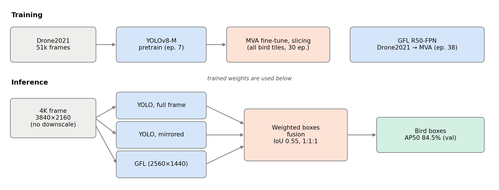
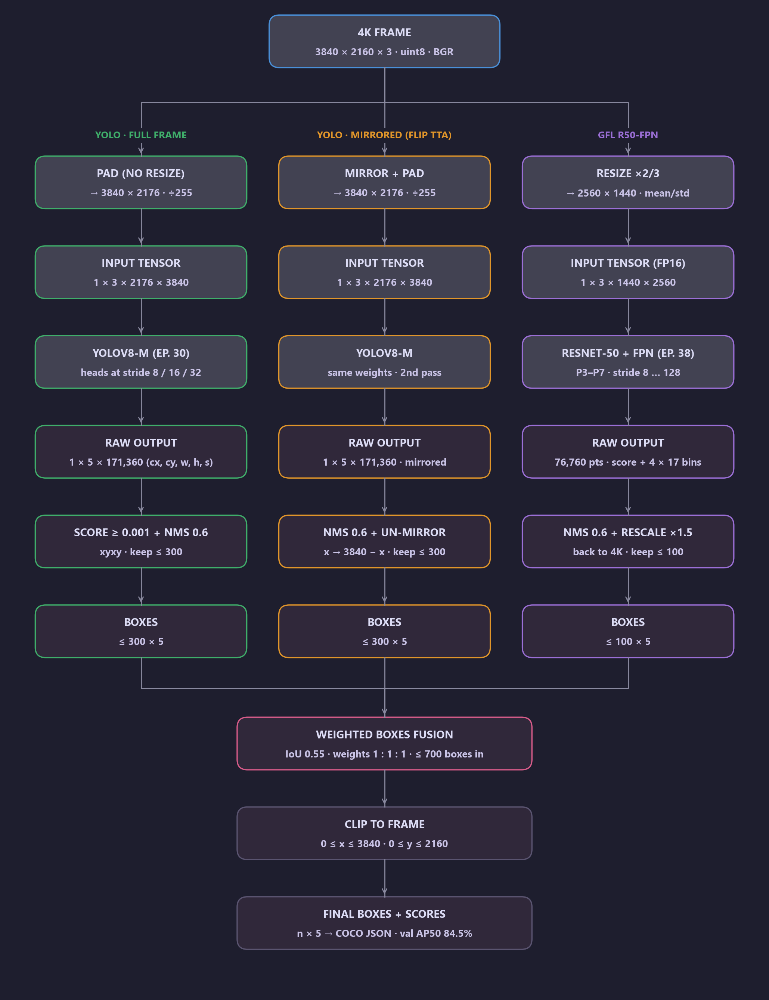
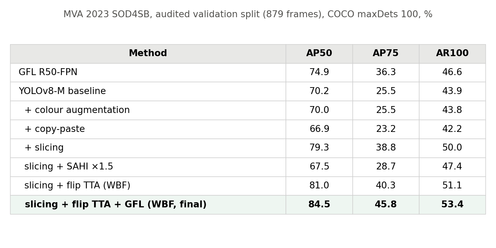

# SOD4SB
Vũ Quốc Đạt, Nguyễn Gia Phúc, Ngô Ngọc Trường Sơn, [Where Should Resolution Be Preserved? Slicing, Tiled Inference and Heterogeneous Box Fusion for Small Bird Detection](paper/main.tex), IEEE-format manuscript, 2026. (PyTorch Code)

## Abstract
  Birds in the MVA 2023 Small Object Detection Challenge for Spotting Birds (SOD4SB) occupy a median of 16 pixels in 3840×2160 frames, which makes every choice that touches image resolution decisive. We study where resolution should be preserved: during training, during inference, or in the fusion of complementary detectors. Starting from a YOLOv8-M detector pretrained on Drone2021 and fine-tuned on native-resolution crops, we compare three training-time data strategies (colour augmentation, copy-paste and exhaustive tile sampling, "slicing"), two inference-time strategies (horizontal-flip test-time augmentation and SAHI tiled inference), several box merging rules, and a heterogeneous ensemble with a GFL ResNet-50 FPN detector. Slicing gives the largest single gain (70.2% to 79.3% AP50), whereas SAHI reduces accuracy (79.3% to 67.5%) when full frames are already processed without downscaling. Weighted boxes fusion (WBF) of flipped and unflipped predictions reaches 81.0%, and a single WBF over YOLO, flipped YOLO and GFL reaches 84.5% AP50 on the validation split, because YOLO is stronger on 8–16 px birds and GFL on 32–64 px birds. All YOLO experiments use YOLOv8-M.

## Framework


### Data flow
From the 4K input frame to the output boxes, with the shape of every intermediate result:


## Result
Performance comparison on the audited MVA 2023 SOD4SB validation split (879 frames, COCO maxDets 100). The final configuration is shown in boldface.


More tables (every epoch, every merging step, scale-wise analysis) are in [`results/`](results).

## Weights
| File | Model | Val AP50 |
|---|---|---|
| `yolov8m_slicing_e30.pt` | YOLOv8-M, Drone2021 → MVA with slicing | 79.3% (81.0% with flip TTA) |
| `gfl_r50_fpn_ep38.pth` | GFL ResNet-50 FPN, Drone2021 → MVA | 74.9% |

Download them from the [Release](../../releases) into [`weights/`](weights) (sizes and SHA-256 checksums in [`weights/README.md`](weights/README.md)).

## Demo
[`demo.ipynb`](demo.ipynb) loads both detectors, runs the final configuration on a validation frame, visualises the boxes and reproduces the main tables. The executed outputs are saved in the notebook.

```python
from model import Detector
det = Detector('weights/yolov8m_slicing_e30.pt', 'weights/gfl_r50_fpn_ep38.pth')
boxes = det('frame.jpg')      # (n, 5): x1, y1, x2, y2, score
```

## Usage
Requirements: Python 3.9, PyTorch 2.7.1 + CUDA 12.8, one GPU with 8 GB.

```bash
pip install -r requirements.txt
pip install torch==2.7.1+cu128 torchvision==0.22.1+cu128 --index-url https://download.pytorch.org/whl/cu128
pip install --target .yolo-deps ultralytics==8.3.40
git clone https://github.com/shinya7y/UniverseNet third_party/UniverseNet
git -C third_party/UniverseNet checkout 3652b18c7ce68122dae7a32670624727d50e0914
```

Data (not redistributed; download from the organisers): see [`data/README`](data/README). Build the audited labels
with `python scripts/prepare_fixed50.py`.

```bash
python train_model.py yolo-pretrain           # YOLOv8-M on Drone2021
python train_model.py yolo --method slicing   # YOLOv8-M on MVA (also: baseline, augmentation, copy_paste)
python train_model.py gfl                     # GFL R50-FPN, Drone2021 then MVA
python main.py                                # final configuration on the validation split: predictions + AP50 / AP75 / AR100
python main.py --limit 20                     # quick check
python main.py --ann none --images path/to/frames --out results.json    # any folder of frames
python evaluate.py results/val_predictions.json --by-size               # evaluate any COCO prediction file
```

Code: [`model.py`](model.py) (detectors and box fusion), [`train_model.py`](train_model.py) (training),
[`evaluate.py`](evaluate.py) (COCO AP50 / AP75 / AR100), [`load_data.py`](load_data.py) (annotations and frames),
[`main.py`](main.py) (inference + evaluation). Every ablation of the paper is in [`scripts/`](scripts):
`eval_sahi_tta.py` (TTA / SAHI), `merge_tune.py`, `sahi_fixed_metrics.py` and `ensemble_wbf.py` (box fusion),
`error_analysis.py` (scale-wise analysis).

## License
[AGPL-3.0](LICENSE), as required by Ultralytics YOLOv8 (AGPL-3.0), which this code uses. UniverseNet and MMDetection
are Apache-2.0. The MVA 2023 and Drone2021 data are not included and keep the terms of their organisers.

## Citing SOD4SB
If you find this work useful in your research, please consider citing:
```
@misc{sod4sb2026,
  title  = {Where Should Resolution Be Preserved? Slicing, Tiled Inference and Heterogeneous Box Fusion for Small Bird Detection},
  author = {Vũ, Quốc Đạt and Nguyễn, Gia Phúc and Ngô, Ngọc Trường Sơn},
  year   = {2026},
  note   = {IEEE-format manuscript}
}
```
